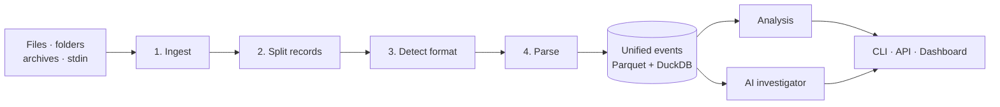

<div align="center">

# LogLens

**Point it at any log. Get structured events, recurring issues, and answers that cite the exact lines.**

[](https://github.com/Tomllrc/LogLens/actions/workflows/ci.yml)

[](https://github.com/astral-sh/ruff)

[](LICENSE)

</div>

> [!NOTE]
> LogLens is in active development. The full pipeline works today from the command line: parsing any log into one event table, AI-taught formats, recurring issues, anomaly detection and run-to-run comparison. The AI investigator, incident reports, HTTP API and web dashboard are next. See [Project status](#project-status).

**New here? Read the [tutorial](docs/tutorial.md)**: why LogLens exists in two minutes, then a 10-minute hands-on investigation of a generated incident.

---

## Why LogLens

When something breaks in production, the answer is usually somewhere in the logs, spread across a Java service's stack traces, an nginx access log, a JSON-lines file from a container, and a rotated `.gz` archive nobody remembers the format of.

Existing tools make you pay one of two costs up front:

- **Log platforms** (ELK, Loki, Splunk) need shippers, agents, and per-format parsing rules *before* you can ask anything.
- **`grep` and `less`** need nothing, but they see lines, not events. A 40-line stack trace is 40 unrelated matches, and they can't tell you that the same error happened 3,000 times with different IDs.

LogLens takes a third route: **no configuration, no assumptions about the format.** You hand it files, folders, or archives. It works out how each file is structured and turns everything into one table of events. Then it finds what matters: which issues recur, what's anomalous, and what happened just before the failure.

## What it does

| | |
|---|---|
| **Reads anything** | Files, nested folders, `.gz` / `.bz2` / `.zip` / `.tar` archives (even archives inside archives), stdin. Any encoding, any line-ending style, any size: files larger than RAM are streamed. |
| **Understands structure** | Groups multi-line records (stack traces, pretty-printed JSON, multi-line SQL) into single events and detects each file's format automatically. |
| **Normalizes** | Every event from every source lands in the same schema: timestamp in UTC, normalized level, component, message, template. Stored as Parquet, queryable with SQL through DuckDB. |
| **Finds patterns** | Mines message templates, so `user 4812 timed out` and `user 77 timed out` become one recurring issue with a count. Ranks issues by impact (`loglens issues`, with the Pareto "vital few"), detects spikes, level shifts, new patterns and broken sequences (`loglens anomalies`), and shows what changed between two runs or two periods (`loglens compare`). |
| **Explains** *(planned)* | Ask questions in plain language ("what happened before the payment service started failing?"). Every answer cites the exact `file:line` it relies on. |

## How it works

LogLens is a streaming pipeline. The key design rule is **universality**: only the parsers know about specific log formats. Everything after parsing sees one unified event schema, so analysis works the same on a syslog, a Kubernetes JSON log, or a format LogLens has never seen before.



1. **Ingest.** Opens every input and streams its lines lazily. Archives are recognized by their content (magic bytes), not their file extension, and unpacked on the fly. Members get traceable names like `logs.tar.gz!/app/server.log`. Binary files are detected and skipped. The encoding is detected per file (BOMs, UTF-16, UTF-8, legacy code pages). Memory stays constant regardless of file size.
2. **Split records.** Learns, per file, what the start of a record looks like (a timestamp, a level token, a JSON object, a bracketed prefix) by scoring candidates on a sample. Continuation lines such as `at com.acme…`, `Caused by:`, `Traceback`, or indented JSON are attached to the record they belong to.
3. **Detect format.** Every candidate format scores a sample of each file's records from 0 to 1. The candidates are JSON, XML, the well-known text formats (syslog RFC 3164 and 5424, Apache/Nginx access, Nginx error, log4j/logback/Spring Boot, Python `logging`, Go `log`, systemd journal export, Windows event exports), text prefix + JSON payload, logfmt, and CSV/TSV (with delimiter and header sniffing). The best score above 0.6 wins, and exact ties go to the more specific format. Otherwise the file is treated as free text. Every score is kept, so ambiguous files are visible.
4. **Parse.** Three strategies, from most to least specific:
   - parsers for known formats. Structured ones (JSON, logfmt, CSV, XML) map their fields automatically. Text formats are declared in YAML, one file per format ([`src/loglens/parsers/patterns/`](src/loglens/parsers/patterns)): a regex with named groups, timestamp hints, a level mapping, and sample lines that double as tests. Adding a format needs no Python code;
   - a generic parser that extracts timestamps and levels, masks variables (IDs, IPs, numbers), and mines message templates with the [Drain](https://jiemingzhu.github.io/pub/pjhe_icws2017.pdf) algorithm;
   - an AI-taught parser: for an unknown format, a language model proposes a parser as a YAML plugin, which is validated against the file before it is used.
5. **Store.** Events are written as Parquet (one folder per source file) with a DuckDB catalog of templates, files and warnings, so any question is one SQL query away (`loglens query`).
6. **Analyze.** Works only on the unified table, so it behaves the same on every format:
   - **recurring issues**: warning and error templates (or, in logs without levels, templates with failure words), merged when Drain split one problem in two, ranked by an explicit impact score with the Pareto "vital few";
   - **anomalies**: volume spikes (robust z-score on the median and MAD), level shifts (change points with [ruptures](https://centre-borelli.github.io/ruptures-docs/)), patterns that first appear late, and broken sequences (a step that is almost always followed by the same next step, until once it isn't);
   - **compare**: new, gone and changed issues between two runs or two periods, with a Poisson rate test so that 1 → 3 events isn't news but 5 → 60 is.

   Every finding cites the `file:line` of its evidence. Rules and thresholds: [docs/analysis.md](docs/analysis.md). Next: an AI investigator that answers questions with citations, and incident reports.

### The unified event

Every event, from any source, has the same shape:

| Field | Meaning |
|---|---|
| `event_id` | Unique identifier |
| `timestamp` / `timestamp_raw` | Parsed time in UTC (nullable), and the original text |
| `source_file`, `line_start`, `line_end` | Exactly where the event came from, including the path inside archives |
| `level` / `level_raw` | Normalized `TRACE` `DEBUG` `INFO` `WARN` `ERROR` `FATAL` `UNKNOWN`, and the original token |
| `component` | Service, logger, or module, when present |
| `message` | The event's message |
| `template_id`, `template`, `params` | The mined template (`user <*> timed out`) and its variable values |
| `format_name`, `parser_confidence` | Which parser produced the event, and how sure it is (0–1) |
| `raw` | The original record text, untouched |

`source_file` and the line range are what make citations possible: any conclusion can be traced back to the exact lines that support it.

## Project status

| Stage | Status |
|---|---|
| Ingestion: files, folders, archives, stdin, encodings, streaming | ✅ Done |
| Record splitting: stack traces, multi-line JSON and SQL | ✅ Done |
| Format detection: 12 formats, per-file scores, `loglens detect` | ✅ Done |
| Parsers for structured formats: JSON, prefix + JSON, CSV/TSV, logfmt, XML, with automatic field mapping | ✅ Done |
| Parsers for 11 text formats declared in YAML: syslog, Apache/Nginx, log4j, Python, Go, journald, Windows events | ✅ Done |
| Generic parser, variable masking, Drain template mining, normalization | ✅ Done |
| Unified event table (Parquet + DuckDB), `loglens parse` and `loglens query` | ✅ Done |
| Format plugins (`loglens formats list/test/new`) and AI-taught formats (`loglens learn`) | ✅ Done |
| Analysis: recurring issues, anomalies, compare (`loglens issues/anomalies/compare`), evaluated on labeled BGL | ✅ Done |
| Command-line interface (`parse`, `query`, `detect`, `issues`, `anomalies`, `compare`, `learn`, `formats`, `doctor`) | ✅ Done |
| AI investigator with cited answers | Next |
| Incident reports (Markdown / HTML) | Next |
| HTTP API and web dashboard | Planned |

## Benchmarks

**Loghub** ([16 public datasets](https://github.com/logpai/loghub), 2,000 lines each, with ground-truth templates), full pipeline, no per-dataset tuning: average **grouping accuracy 75.8%**, parsing accuracy 33.4%, timestamps found on 100% of lines, about **23,000 lines/s per worker**. Per-dataset table: [benchmarks/RESULTS.md](benchmarks/RESULTS.md); what failed and what was fixed: [benchmarks/ANALYSIS.md](benchmarks/ANALYSIS.md).

**Anomaly detection on labeled BGL** (4.7M lines, labels removed before parsing, thresholds fixed before the first run): reported honestly, the detectors (F1 14.7%) lose to the simplest baseline, flagging every ERROR/FATAL line (F1 52.2%), because BGL labels individual lines and those lines carry the log's own FATAL level, while the detectors are built to say *when* something changed. Numbers: [benchmarks/ANOMALY_RESULTS.md](benchmarks/ANOMALY_RESULTS.md); discussion: [docs/analysis.md](docs/analysis.md#evaluation-on-labeled-data-bgl).

Text-format parsing (regex match, field mapping, level normalization, event construction), measured with [`benchmarks/bench_text_formats.py`](benchmarks/bench_text_formats.py) on one core of a laptop, Python 3.13:

| Format | Records/s |
|---|---:|
| syslog RFC 3164 | 341k |
| Apache common | 239k |
| Nginx error | 196k |
| syslog RFC 5424 | 163k |
| Apache / Nginx combined | 145k |
| log4j, Python logging, Go log (incl. multi-line records) | 296k–388k |
| systemd journal export (≈13 lines per entry) | 90k entries |

Every single-line format is above the 100k records/s target. Ingestion streams files of any size in constant memory (checked with `tracemalloc` in the test suite).

## Getting started

Requires Python 3.11+ and [uv](https://docs.astral.sh/uv/).

```bash
git clone https://github.com/Tomllrc/LogLens.git
cd LogLens
uv sync
uv run loglens --version
```

### Find what went wrong in 24 hours of logs

The [tutorial](docs/tutorial.md) walks through this example step by step. In short: the repository can generate a realistic test case: 24 hours of a web app and a job worker (13,047 lines, plain text, no format declared) with five planted problems. LogLens isn't told what they are.

```bash
uv run python tests/fixtures/make_analysis_fixtures.py data/demo   # writes data/demo/scenario-text/
uv run loglens parse data/demo/scenario-text -o out                # 13,047 events, 13 templates, 0.6 s
uv run loglens issues out
uv run loglens anomalies out
```

`loglens issues` ranks recurring problems by impact. The two variants of the connection error ("refused by peer" and "refused by remote peer") are merged into one issue:

```text
  #   Impact   Share   Cum.   Events   First seen            Last seen             Issue
  1    1,120   40.5%    41%      224   2026-03-01 00:00:13   2026-03-01 23:00:13   Payment gateway timeout after <DURATION>
  2      900   32.6%    73%      180   2026-03-01 18:00:23   2026-03-01 23:58:23   Disk quota exceeded on volume <PATH>
  3      600   21.7%    95%      120   2026-03-01 00:00:17   2026-03-01 23:48:17   Connection to <IP> refused by peer (+1 similar)
  4      144    5.2%   100%      144   2026-03-01 00:00:07   2026-03-01 23:50:07   Cache miss rate high for region <*>

3 of 4 issues account for 95% of impact (bold rows).
```

`loglens anomalies` finds the other planted problems at the right time, each with the line to look at (abridged):

```text
2026-03-01 00:00:00 -> 2026-03-01 23:59:30, 288 buckets of 5m
Spike        06:30:00   Payment gateway timeout after <DURATION>: 200 in one 5m bucket (median 0)   app.log:3964
Level shift  12:00:00   total volume x2.7 down (64 -> 24 per 5m)                                     app.log:7545
Level shift  18:00:00   ERROR volume x6.0 up (0 -> 3 per 5m)                                         app.log:8405
New pattern  18:00:23   Disk quota exceeded on volume <PATH> (180 events)                            app.log:8407
Rare transition 18:00:01  'Job <NUM> step load skipped from cache' after 'Job <NUM> started on
                          worker pool' (1 of 1,200; usually 'Job <NUM> step load done')               worker.log:2702
```

The same scenario written as JSON lines gives the same analysis, and a clean twin without the planted problems raises no spike, level shift or rare transition (both are checked in the test suite). Two runs or two periods can be compared:

```bash
uv run loglens compare out --split 2026-03-01T12:00:00Z    # before noon vs after
uv run loglens compare yesterday/ today/                   # two parse runs
```

```text
New issues
  Before/h   After/h   Ratio       p   Issue
       0.0      15.0       -       -   Disk quota exceeded on volume <PATH>
Changed issues
      17.7       1.0   x17.7   2e-48   Payment gateway timeout after <DURATION>

Baseline: 9,344 events, 2.9% errors. Target: 3,703 events, 6.8% errors.
```

Every analysis command also takes `--json`, and `--since` / `--until` to narrow the window.

### Query events with SQL

The event table is plain Parquet behind a DuckDB view named `events`:

```bash
uv run loglens query out "SELECT level, count(*) AS n FROM events GROUP BY level ORDER BY n DESC"
```

```text
  level   n
  INFO    12379
  ERROR   524
  WARN    144
```

From Python, `loglens.store.connect("out")` returns a read-only DuckDB connection with the same view.

### Detect the format of every file

Given `logs.tar.gz`, which contains a Java service log and a gzipped JSON log:

```text
$ loglens detect logs.tar.gz
  File                                 Format   Confidence   Details   Runner-up
 ──────────────────────────────────────────────────────────────────────────────
  logs.tar.gz!/logs/app.log            log4j          1.00
  logs.tar.gz!/logs/payments.json.gz   json           1.00
```

The archive, and the gzip file nested inside it, are opened transparently. `Details` shows what a format learned about the file (for CSV: `delimiter=tab, columns=4, header=no`). `Runner-up` shows the next-best candidate, so ambiguous files are easy to spot. Folders, several paths, and stdin (`-`) work too.

### Teach LogLens a new format

Any log layout can be added as a YAML plugin in `~/.loglens/formats/` (or a folder given with `--formats-dir`). User formats override built-in ones with the same name.

```bash
uv run loglens formats list                         # built-in and user formats, invalid plugins
uv run loglens formats new --sample my.log          # wizard: write a regex, test it live, save
uv run loglens formats test my_format.yaml my.log   # match rate, matched fields, misses
```

Or let a language model write the plugin. `loglens learn my.log` sends about 50 varied sample lines to Gemini in one call. It validates the proposed parser on up to 10,000 records, and retries with the lines it missed until it matches at least 95% (3 retries at most). It then saves the YAML with its provenance. `loglens parse --learn` does the same for every file it could only parse with low confidence. On three invented formats (a PLC alarm journal, a game server, a pipe-delimited service log), the generic parser found 0% of timestamps, levels and components; each learned format reached 100%, on the first attempt ([docs/ai-parser.md](docs/ai-parser.md)).

AI features need the optional extra (`uv sync --extra ai`) and a free [Gemini API key](https://aistudio.google.com/apikey) in a `.env` file (copy [`.env.example`](.env.example); `.env` is git-ignored). `loglens doctor` checks the setup without ever printing the key. Every command prints the tokens it used. Answers are cached, so re-running a command costs nothing.

> [!WARNING]
> **Privacy.** AI commands send log samples to Google. On the free tier, Google may use prompts and responses to improve its products. Only send logs you are allowed to share. `--no-ai`, `LOGLENS_AI=0`, or `ai: false` in `~/.loglens/config.yaml` turns every AI feature off, and everything else works without it.

### Use the pipeline from Python

Everything the CLI does is available as a library:

```python
from pathlib import Path

from loglens.analysis.issues import find_issues
from loglens.pipeline import run_parse
from loglens.store import connect

if __name__ == "__main__":  # parsing uses a process pool
    run_parse(["data/demo/scenario-text"], Path("out"))

    conn = connect(Path("out"))  # read-only DuckDB connection
    for issue in find_issues(conn).issues[:2]:
        first = issue.evidence[0]
        print(f"{issue.impact:>6.0f}  {issue.title}  ({first.source_file}:{first.line_start})")

    sql = "SELECT level, count(*) FROM events GROUP BY level ORDER BY 2 DESC"
    print(conn.execute(sql).fetchall())
```

```text
  1120  Payment gateway timeout after <DURATION>  (data/demo/scenario-text/app.log:4)
   900  Disk quota exceeded on volume <PATH>  (data/demo/scenario-text/app.log:8407)
[('INFO', 12379), ('ERROR', 524), ('WARN', 144)]
```

Each stage can also be used alone, lazily: `loglens.ingest.iter_lines()` → `loglens.split.iter_records()` → `loglens.detect.iter_detected()`.

## Design principles

- **Universal by construction.** No analysis code may depend on a specific log format. Format knowledge lives only in parsers.
- **Streaming, always.** Data flows through generators. No stage loads a whole file into memory; this is enforced by memory tests.
- **Never crash on bad input.** Corrupt archives, undecodable bytes, and malformed lines become warnings in a report, or events with level `UNKNOWN` and low parser confidence. They never become a stack trace.
- **Traceable.** Every event keeps its source file and line range, and every answer must cite them.

## Development

```bash
uv sync                 # install dependencies, including dev tools
uv run ruff check       # lint
uv run mypy src         # type check (strict)
uv run pytest --cov     # tests with coverage
```

CI runs all three on Python 3.11 and 3.12 for every push and pull request. The test suite includes property-based tests ([Hypothesis](https://hypothesis.readthedocs.io/)) and memory-bound tests with `tracemalloc`.

```text
src/loglens/
├── ingest/     files, folders, archives, stdin, encodings → lines
├── split/      lines → multi-line records
├── detect/     format detection
├── parsers/    known-format, generic (Drain), YAML text formats, masking, template mining
├── schema/     the unified event schema, level normalization
├── pipeline/   orchestration: ingest → split → detect → parse, one worker process per input
├── store/      Parquet writer and the DuckDB catalog
├── analysis/   recurring issues, anomalies, compare (aggregates.py is the only SQL)
├── ai/         LLM interface (Gemini, fake client for tests), AI format learner
├── api/        HTTP API (planned)
└── cli/        `loglens` commands, one module per command group
```

Design notes: [docs/analysis.md](docs/analysis.md) (analysis rules), [docs/ai-parser.md](docs/ai-parser.md) (AI-taught formats), [docs/decisions.md](docs/decisions.md) (every judgment call, with its reason).

Changes are tracked in [CHANGELOG.md](CHANGELOG.md).

## License

[MIT](LICENSE)
