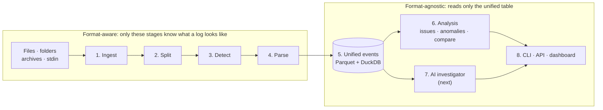

<div align="center">

# LogLens

**Point it at any log. Get structured events, the issues that matter, and findings that cite the exact lines.**

[](https://github.com/Tomllrc/LogLens/actions/workflows/ci.yml)

[](https://github.com/astral-sh/ruff)


[](LICENSE)

[Tutorial](docs/tutorial.md) · [Architecture](#how-it-works) · [Results](#results-measured-not-claimed) · [Decisions](docs/decisions.md) · [Roadmap](#roadmap)

</div>

---

## The problem

It is Monday morning. Payments failed for a while over the weekend, and someone has to find out what happened. The evidence is in the logs: a Java service with stack traces, an nginx access log, JSON lines from a container, and a rotated `.gz` archive nobody remembers the format of.

Every existing option charges up front:

- **Log platforms** (ELK, Splunk, Loki) answer anything, once someone has installed shippers and written a parsing rule for every format. That is days, not minutes.
- **`grep` and `less`** need nothing, but they see lines, not events. A 40-line stack trace is 40 unrelated matches, and they cannot tell you the same error happened 3,000 times with different IDs.

**LogLens removes the setup.** You hand it files, folders or archives with no configuration and no format declared. It works out how each file is structured, turns everything into one table of events, and answers the first questions of an investigation. Every finding points to the file and line that support it, so it can always be checked against the original log.

| Question | Command | Answer |
|---|---|---|
| What is in these files? | `loglens detect` | Format of every file, with a confidence score |
| What keeps going wrong? | `loglens issues` | Recurring problems ranked by impact, and the vital few causing most of it |
| When did it go wrong? | `loglens anomalies` | Spikes, drops, new errors and broken sequences, with timestamps |
| What changed? | `loglens compare` | New, gone and changed issues between two periods or two runs |
| Anything else? | `loglens query` | SQL over every event |
| What does this log look like? | `loglens learn` | An AI-written parser, validated on the file before it is used |

## What it looks like

Twenty-four hours of a web app and a job worker, 13,047 lines of plain text, five planted problems. LogLens is not told what they are. (The repository generates this scenario; the [tutorial](docs/tutorial.md) walks through it.)

```bash
uv run python tests/fixtures/make_analysis_fixtures.py data/demo
uv run loglens parse data/demo/scenario-text -o out      # 13,047 events, 13 templates, 0.6 s
uv run loglens issues out
```

```text
  #   Impact   Share   Cum.   Events   First seen            Last seen             Issue
  1    1,120   40.5%    41%      224   2026-03-01 00:00:13   2026-03-01 23:00:13   Payment gateway timeout after <DURATION>
  2      900   32.6%    73%      180   2026-03-01 18:00:23   2026-03-01 23:58:23   Disk quota exceeded on volume <PATH>
  3      600   21.7%    95%      120   2026-03-01 00:00:17   2026-03-01 23:48:17   Connection to <IP> refused by peer (+1 similar)
  4      144    5.2%   100%      144   2026-03-01 00:00:07   2026-03-01 23:50:07   Cache miss rate high for region <*>

3 of 4 issues account for 95% of impact (bold rows).
```

Two wordings of the same connection error were merged into one issue. `loglens anomalies` then says *when* things changed, each finding with the line to open:

```text
2026-03-01 00:00:00 -> 2026-03-01 23:59:30, 288 buckets of 5m
Spike           06:30:00   Payment gateway timeout after <DURATION>: 200 in one 5m bucket (median 0)   app.log:3964
Level shift     12:00:00   total volume x2.7 down (64 -> 24 per 5m)                                     app.log:7545
Level shift     18:00:00   ERROR volume x6.0 up (0 -> 3 per 5m)                                         app.log:8405
New pattern     18:00:23   Disk quota exceeded on volume <PATH> (180 events)                            app.log:8407
Rare transition 18:00:01   'Job <NUM> step load skipped from cache' after 'Job <NUM> started on
                           worker pool' (1 of 1,200; usually 'Job <NUM> step load done')               worker.log:2702
```

All five planted problems are found. The same scenario written as JSON lines gives the same analysis, and a clean twin without the problems raises nothing. Both facts are checked in the test suite.

## How it works

LogLens is one streaming pipeline: any format in, one event schema out. The key design rule is a **format boundary**. Only the four stages above the line know what a log looks like. Everything below works on the unified table, so analysis behaves the same on a syslog, a Kubernetes JSON log, or a format LogLens has never seen.



**Above the boundary, format-aware:**

1. **Ingest** streams lines from files, folders, stdin, and `.gz` / `.bz2` / `.zip` / `.tar` archives at any nesting depth. Archives are recognized by content, not extension. The encoding is detected per file. Memory stays constant whatever the file size.
2. **Split** learns, per file, what the start of a record looks like and attaches continuation lines (`at com.acme…`, `Caused by:`, `Traceback`, indented JSON) to the record they belong to.
3. **Detect** has 17 detectors score a sample of each file from 0 to 1. The best score above 0.6 wins. Every score is kept, so ambiguous files are visible.
4. **Parse** with three strategies, most specific first: known-format parsers (JSON, logfmt, CSV, XML, and 11 text formats declared in YAML, one file per format, no Python needed); a generic parser that extracts timestamps and levels, masks variables and mines message templates with [Drain](https://jiemingzhu.github.io/pub/pjhe_icws2017.pdf); and an AI-taught parser that writes a YAML plugin for an unknown format and validates it on the file before using it.

**Below the boundary, format-agnostic:**

5. **Unified event table**, stored as Parquet with a DuckDB catalog. Every event has the same 16 fields; the ones that matter most are `source_file`, `line_start` and `line_end`, because they are what make every citation possible. Bad input never crashes the pipeline: a malformed line becomes an event with level `UNKNOWN` and a low confidence, and is counted in a warnings report.
6. **Analysis**, no AI needed: recurring issues ranked by an explicit impact score, anomalies (robust z-scores, change points, late-appearing patterns, broken sequences), and comparison of two periods with a Poisson rate test so that 1 → 3 events is not news but 5 → 60 is. Rules and thresholds: [docs/analysis.md](docs/analysis.md).
7. **AI investigator** *(next)*: plain-language questions, answered through read-only tools over the table, with citations validated against the table before the answer is shown.
8. **Interface**: CLI today, HTTP API and dashboard planned.

<details>
<summary>The unified event, field by field</summary>

| Field | Meaning |
|---|---|
| `event_id` | Unique identifier |
| `timestamp` / `timestamp_raw` | Parsed time in UTC (nullable), and the original text |
| `source_file`, `line_start`, `line_end` | Exactly where the event came from, including the path inside archives |
| `level` / `level_raw` | Normalized `TRACE` `DEBUG` `INFO` `WARN` `ERROR` `FATAL` `UNKNOWN`, and the original token |
| `component` | Service, logger, or module, when present |
| `message` | The event's message |
| `template_id`, `template`, `params` | The mined template (`user <*> timed out`) and its variable values |
| `format_name`, `parser_confidence` | Which parser produced the event, and how sure it is (0–1) |
| `raw` | The original record text, untouched |

</details>

## Results: measured, not claimed

**Parsing, on public data with ground truth.** [Loghub](https://github.com/logpai/loghub), 16 datasets, 2,000 lines each, full pipeline, no per-dataset tuning.

| Metric | Result |
|---|---:|
| Grouping accuracy (average over 16 datasets) | 75.8% |
| Parsing accuracy | 33.4% |
| Timestamps found and correct | 100% |
| Throughput, full pipeline, one worker | ~23,000 lines/s |

Per-dataset numbers: [benchmarks/RESULTS.md](benchmarks/RESULTS.md). What failed and what was fixed: [benchmarks/ANALYSIS.md](benchmarks/ANALYSIS.md). The fixes were general ones only; Drain's similarity threshold was never tuned to a dataset ([D11](docs/decisions.md)).

**Anomaly detection, on labeled data.** BGL, 4.7 million lines, labels removed before parsing, thresholds fixed before the first run ([D23](docs/decisions.md), [D27](docs/decisions.md)).

| Method | F1 |
|---|---:|
| LogLens detectors | 14.7% |
| Baseline: flag every ERROR/FATAL line | 52.2% |

The detectors lose to the simplest baseline, and the result is published as is. BGL labels individual lines, and those lines already carry the log's own FATAL level, while the detectors are built to answer a different question: *when* did something change. Numbers: [benchmarks/ANOMALY_RESULTS.md](benchmarks/ANOMALY_RESULTS.md); discussion: [docs/analysis.md](docs/analysis.md#evaluation-on-labeled-data-bgl).

**AI-taught formats.** On three invented formats (a PLC alarm journal, a game server, a pipe-delimited service log), the generic parser found 0% of timestamps, levels and components. Each learned format reached 100% on the first attempt, with one API call each ([docs/ai-parser.md](docs/ai-parser.md)).

**Text-format parsing speed**, one laptop core: every single-line format is above 145,000 records/s ([benchmark](benchmarks/bench_text_formats.py)). Ingestion runs in constant memory on files of any size, checked with `tracemalloc` in the test suite.

## Engineering judgment

Every non-obvious call is written down with its reason in [docs/decisions.md](docs/decisions.md) (27 so far). A few that shaped the project:

- **Universality is enforced, not hoped for.** No analysis code may depend on a log format. All SQL lives in one file; everything else in analysis is a pure function over bounded aggregates ([D21](docs/decisions.md)).
- **No tuning to the test.** Benchmark fixes must be general. Detector rules were frozen before the labeled evaluation, so the BGL result above is an honest one ([D11](docs/decisions.md), [D23](docs/decisions.md)).
- **AI is optional, cheap and auditable.** The model only ever writes a parser plugin, which is validated on up to 10,000 records before use and saved with its provenance and real match rate ([D19](docs/decisions.md)). Responses are cached; the free tier's quota is handled with per-model fallback ([D20](docs/decisions.md)). Everything except `learn` works with AI turned off.
- **Privacy is a flag away.** AI commands send log samples to Google. `--no-ai`, `LOGLENS_AI=0` or `ai: false` in the config turns every AI feature off. The API key is read from one environment variable, never printed, and never logged. `loglens doctor` checks the setup without showing it.
- **Never crash on bad input.** Corrupt archives, undecodable bytes and malformed lines become warnings or low-confidence events, never a stack trace.

## Getting started

Requires Python 3.11+ and [uv](https://docs.astral.sh/uv/).

```bash
git clone https://github.com/Tomllrc/LogLens.git
cd LogLens
uv sync
uv run loglens --version
```

Then follow the [tutorial](docs/tutorial.md): the incident above, investigated end to end in about ten minutes. Every output in it is real.

<details>
<summary>Query with SQL</summary>

The event table is plain Parquet behind a DuckDB view named `events`:

```bash
uv run loglens query out "SELECT level, count(*) AS n FROM events GROUP BY level ORDER BY n DESC"
```

```text
  level   n
  INFO    12379
  ERROR   524
  WARN    144
```

</details>

<details>
<summary>Compare two periods or two runs</summary>

```bash
uv run loglens compare out --split 2026-03-01T12:00:00Z    # before noon vs after
uv run loglens compare yesterday/ today/                   # two parse runs
```

```text
New issues
  Before/h   After/h   Ratio       p   Issue
       0.0      15.0       -       -   Disk quota exceeded on volume <PATH>
Changed issues
      17.7       1.0   x17.7   2e-48   Payment gateway timeout after <DURATION>

Baseline: 9,344 events, 2.9% errors. Target: 3,703 events, 6.8% errors.
```

Every analysis command also takes `--json`, and `--since` / `--until` to narrow the window.

</details>

<details>
<summary>Detect formats inside archives</summary>

```text
$ loglens detect logs.tar.gz
  File                                 Format   Confidence   Details   Runner-up
 ──────────────────────────────────────────────────────────────────────────────
  logs.tar.gz!/logs/app.log            log4j          1.00
  logs.tar.gz!/logs/payments.json.gz   json           1.00
```

The archive, and the gzip file nested inside it, are opened transparently. `Runner-up` shows the next-best candidate, so ambiguous files are easy to spot.

</details>

<details>
<summary>Teach LogLens a new format, by hand or with AI</summary>

Any layout can be added as a YAML plugin in `~/.loglens/formats/` (or a folder given with `--formats-dir`).

```bash
uv run loglens formats list                         # built-in and user formats
uv run loglens formats new --sample my.log          # wizard: write a regex, test it live, save
uv run loglens formats test my_format.yaml my.log   # match rate, matched fields, misses
```

Or let a model write it. `loglens learn my.log` sends about 50 varied sample lines to Gemini in one call, validates the proposed parser on up to 10,000 records, and retries with the lines it missed until it matches at least 95%. `loglens parse --learn` does the same for every file it could only parse with low confidence.

AI features need the optional extra (`uv sync --extra ai`) and a free [Gemini API key](https://aistudio.google.com/apikey) in a `.env` file (copy [`.env.example`](.env.example); `.env` is git-ignored).

> [!WARNING]
> AI commands send log samples to Google. On the free tier, Google may use prompts and responses to improve its products. Only send logs you are allowed to share.

</details>

<details>
<summary>Use it from Python</summary>

```python
from pathlib import Path

from loglens.analysis.issues import find_issues
from loglens.pipeline import run_parse
from loglens.store import connect

if __name__ == "__main__":  # parsing uses a process pool
    run_parse(["data/demo/scenario-text"], Path("out"))

    conn = connect(Path("out"))  # read-only DuckDB connection
    for issue in find_issues(conn).issues[:2]:
        first = issue.evidence[0]
        print(f"{issue.impact:>6.0f}  {issue.title}  ({first.source_file}:{first.line_start})")
```

```text
  1120  Payment gateway timeout after <DURATION>  (data/demo/scenario-text/app.log:4)
   900  Disk quota exceeded on volume <PATH>  (data/demo/scenario-text/app.log:8407)
```

Each stage can also be used alone, lazily: `loglens.ingest.iter_lines()` → `loglens.split.iter_records()` → `loglens.detect.iter_detected()`.

</details>

## Roadmap

| Stage | Status |
|---|---|
| Ingestion: files, folders, archives, stdin, encodings, constant memory | ✅ |
| Record splitting: stack traces, multi-line JSON and SQL | ✅ |
| Format detection: 17 detectors, per-file scores | ✅ |
| Parsers: 5 structured formats, 11 text formats in YAML, generic parser with Drain | ✅ |
| Unified event table (Parquet + DuckDB), `parse` and `query` | ✅ |
| Format plugins and AI-taught formats (`formats`, `learn`) | ✅ |
| Analysis: `issues`, `anomalies`, `compare`, evaluated on labeled data | ✅ |
| AI investigator with validated citations | Next |
| Incident reports (Markdown / HTML) | Next |
| HTTP API and web dashboard | Planned |

## Development

```bash
uv sync                 # install dependencies, including dev tools
uv run ruff check       # lint
uv run mypy src         # type check (strict)
uv run pytest --cov     # 1,232 tests, 98% coverage
```

CI runs all three on Python 3.11 and 3.12 for every push and pull request. The suite includes property-based tests ([Hypothesis](https://hypothesis.readthedocs.io/)), memory-bound tests with `tracemalloc`, and sample lines from every YAML format that become tests automatically. CI never calls a real AI API: tests use a fake client.

```text
src/loglens/
├── ingest/     files, folders, archives, stdin, encodings → lines
├── split/      lines → multi-line records
├── detect/     format detection
├── parsers/    known-format, generic (Drain), YAML text formats, masking, template mining
├── schema/     the unified event schema, level normalization
├── pipeline/   orchestration: ingest → split → detect → parse, one worker process per input
├── store/      Parquet writer and the DuckDB catalog
├── analysis/   recurring issues, anomalies, compare (aggregates.py is the only SQL)
├── ai/         LLM interface (Gemini, fake client for tests), AI format learner
└── cli/        `loglens` commands, one module per command group
```

Design notes: [docs/analysis.md](docs/analysis.md), [docs/ai-parser.md](docs/ai-parser.md), [docs/decisions.md](docs/decisions.md). Changes: [CHANGELOG.md](CHANGELOG.md).

## License

[MIT](LICENSE)
