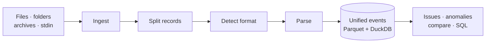

# LogLens tutorial: why use it, and how

This guide is written for someone discovering the project, for example a recruiter or a
hiring engineer. It has three parts:

1. **[Why LogLens](#part-1-why-loglens)**: the problem it solves, in two minutes, no
   install needed.
2. **[Hands-on](#part-2-hands-on)**: about 10 minutes on your own machine. You
   investigate a realistic incident from start to finish.
3. **[How it is built](#part-3-how-it-is-built)**: for the technical reader, what
   to look at in the code and how quality is checked.

Every output shown below was produced by the commands next to it, on the data the
repository generates. Nothing is mocked up.

---

## Part 1: Why LogLens

### The situation

It is Monday morning. Payments failed for a while over the weekend, and someone has
to find out what happened. The evidence is in the logs: a web application and a
background job worker, 13,000 lines for one day, with no documentation of their format.

The usual options are poor:

- **Read them with `grep` and `less`.** You see lines, not events. You can search for
  `error`, but you can't easily tell that one error happened 224 times with a different
  number each time, that another one only started at 18:00, or that traffic halved at
  noon.
- **Load them into a log platform** (ELK, Splunk, Loki). That works, after someone has
  installed shippers and written a parsing rule for every format. That is days of work,
  not minutes.

### What LogLens does instead

You point LogLens at the files, folders or archives, with **no configuration and no
format declared**. It works out how each file is structured, turns every line into a
structured event, and answers the first questions of an investigation:

| Question | Command | What you get |
|---|---|---|
| What is in these files? | `loglens detect` | The format of each file, with a confidence score |
| What keeps going wrong? | `loglens issues` | Recurring problems ranked by impact, and the few that cause most of it |
| When did things go wrong? | `loglens anomalies` | Bursts, drops, new errors and broken sequences, with timestamps |
| What changed? | `loglens compare` | New, gone and changed issues between two days or two periods |
| Anything else | `loglens query` | SQL over every event |

Every finding points to the **exact file and line** to look at, so the result can always
be checked against the original log.

### What makes it different

- **Any format, no setup.** It recognizes JSON, CSV, XML, logfmt, syslog, Apache/Nginx,
  Java (log4j/logback), Python, Go, systemd and Windows event logs by itself, and handles
  the rest as free text. For a format nobody has seen before, an AI model can write a
  parser once, which LogLens checks before using it and then runs locally.
- **Same answers whatever the format.** Analysis only ever sees one unified event table.
  The same incident written as plain text or as JSON gives the same results (part 2,
  step 8).
- **Traceable.** No conclusion without the line numbers that support it.
- **Honest numbers.** It is benchmarked on public datasets with ground truth, and the
  results are published even where a simple baseline does better
  ([benchmarks](#measured-not-claimed)).

---

## Part 2: Hands-on

You will investigate a generated incident: 24 hours of a web app and a job worker with
**five hidden problems**. LogLens is not told what they are. You can check its findings
against the list at the end of step 5.

### Step 0: Install (2-3 minutes)

You need **Git**, **Python 3.11 or newer** and **[uv](https://docs.astral.sh/uv/)**, a
fast Python package manager.

```bash
# Install uv, if you don't have it
# macOS / Linux:
curl -LsSf https://astral.sh/uv/install.sh | sh
# Windows (PowerShell):
powershell -ExecutionPolicy ByPass -c "irm https://astral.sh/uv/install.ps1 | iex"
```

Then get LogLens and its dependencies:

```bash
git clone https://github.com/Tomllrc/LogLens.git
cd LogLens
uv sync
uv run loglens --version
```

```text
loglens 0.1.0
```

All the commands below are run from the `LogLens` folder. Generated files go under
`data/`, which Git ignores.

### Step 1: Create a realistic incident

```bash
uv run python tests/fixtures/make_analysis_fixtures.py data/demo
```

This writes four folders under `data/demo/`: the incident as plain text
(`scenario-text`) and as JSON lines (`scenario-json`), and the same day *without* the
problems (`background-text`, `background-json`), which you will use for comparison. The
data is synthetic and deterministic: you get exactly the numbers shown here.

The first lines of `data/demo/scenario-text/app.log`:

```text
2026-03-01T00:00:00.000Z INFO [api] Cache hit for key k27
2026-03-01T00:00:06.666Z INFO [api] Scheduled task t123 completed
2026-03-01T00:00:07.000Z WARN [cache] Cache miss rate high for region eu
2026-03-01T00:00:13.000Z ERROR [payments] Payment gateway timeout after 5144 ms
2026-03-01T00:00:13.333Z INFO [api] User u24 logged in from 10.1.0.24
2026-03-01T00:00:17.000Z ERROR [db] Connection to 10.0.3.242 refused by peer
```

And the same events in `data/demo/scenario-json/app.jsonl`:

```text
{"time": "2026-03-01T00:00:00.000Z", "level": "info", "service": "api", "message": "Cache hit for key k27"}
{"time": "2026-03-01T00:00:06.666Z", "level": "info", "service": "api", "message": "Scheduled task t123 completed"}
```

### Step 2: Let LogLens look at the files

```bash
uv run loglens detect data/demo/scenario-text data/demo/scenario-json
```

```text
  File                                   Format      Confidence
  data/demo/scenario-text/app.log        free_text         0.10
  data/demo/scenario-text/worker.log     free_text         0.10
  data/demo/scenario-json/app.jsonl      json              1.00
  data/demo/scenario-json/worker.jsonl   json              1.00
```

The JSON files are recognized with full confidence. The text files match no known
format, so they will go through the generic parser, which finds timestamps and levels
on its own. To see detection on many formats at once, try
`uv run loglens detect tests/fixtures/detect`: 18 sample files, including Apache, Nginx,
syslog, log4j, CSV with and without a header, TSV, XML and pretty-printed JSON.

### Step 3: Turn the logs into events

```bash
uv run loglens parse data/demo/scenario-text -o data/out
```

Abridged output:

```text
Parsed into data/out
  Source files                   2     Format      Files      Level   Events
  Records                   13,047     free_text       2      INFO    12,379
  Events                    13,047                            WARN       144
  Templates                     13                            ERROR      524
  Throughput      24,935 records/s
  Low confidence              0.0%
  Time                      0.52 s

Top error templates
  Events   Template
     224   Payment gateway timeout after <DURATION>
     180   Disk quota exceeded on volume <PATH>
      60   Connection to <IP> refused by peer
      60   Connection to <IP> refused by remote peer
```

Two things happened here:

- Every line became an **event** with a UTC timestamp, a normalized level, a component
  and a message. They are stored in `data/out/` as Parquet files with a DuckDB database
  next to them.
- 13,047 lines were reduced to **13 templates**. LogLens masks the variable parts (IDs,
  IP addresses, durations, paths) and groups messages that only differ by those. So
  `Payment gateway timeout after 5144 ms` and `... after 4536 ms` count as one thing
  that happened 224 times.

### Step 4: What keeps going wrong?

```bash
uv run loglens issues data/out
```

```text
  #   Impact   Share   Cum.   Events   First seen            Last seen             Issue
  1    1,120   40.5%    41%      224   2026-03-01 00:00:13   2026-03-01 23:00:13   Payment gateway timeout after <DURATION>
  2      900   32.6%    73%      180   2026-03-01 18:00:23   2026-03-01 23:58:23   Disk quota exceeded on volume <PATH>
  3      600   21.7%    95%      120   2026-03-01 00:00:17   2026-03-01 23:48:17   Connection to <IP> refused by peer (+1 similar)
  4      144    5.2%   100%      144   2026-03-01 00:00:07   2026-03-01 23:50:07   Cache miss rate high for region <*>

3 of 4 issues account for 95% of impact (bold rows).
```

How to read it:

- **Impact** weighs each event by its severity: a fatal error counts 10, an error 5,
  a warning 1. It's a simple rule, so you can explain the ranking to anyone.
- **Share** and **Cum.** give the Pareto view: the last line says which few issues
  account for most of the trouble, so you know where to start.
- **"(+1 similar)"**: the connection error appears in two wordings ("refused by peer"
  and "refused by remote peer"). LogLens merged them into one issue because their words
  overlap almost entirely.

`--json` gives the same result as JSON, and `--since` / `--until` narrow the time window.

### Step 5: When did things go wrong?

```bash
uv run loglens anomalies data/out
```

Abridged output (the real one has a table per kind of anomaly, with a score):

```text
2026-03-01 00:00:00 -> 2026-03-01 23:59:30, 288 buckets of 5m
Spike            06:30:00   Payment gateway timeout after <DURATION>: 200 in one 5m bucket (median 0)   app.log:3964
Level shift      12:00:00   total volume x2.7 down (64 -> 24 per 5m)                                     app.log:7545
Level shift      18:00:00   ERROR volume x6.0 up (0 -> 3 per 5m)                                         app.log:8405
New pattern      18:00:23   new: Disk quota exceeded on volume <PATH> (180 events)                       app.log:8407
Rare transition  18:00:01   'Job <NUM> step load skipped from cache' after 'Job <NUM> started on
                            worker pool' (1 of 1,200; usually 'Job <NUM> step load done')               worker.log:2702
```

LogLens cut the day into 5-minute buckets (it picks the size by itself) and looked for
four kinds of anomaly. Here are the five planted problems, and what found them:

| Planted problem | Found by |
|---|---|
| A burst of 200 payment timeouts at 06:30 | **Spike**: 200 in one bucket where the usual count is 0 |
| Traffic drops to a quarter from 12:00 | **Level shift**: volume down from 64 to 24 events per bucket |
| A new error, "disk quota exceeded", from 18:00 | **New pattern**, and a level shift in the error volume |
| One job (out of 1,200) skips a step | **Rare transition**: "started" is followed by "step load done" every other time |
| One error written two different ways | **Issues** (step 4): merged as "(+1 similar)" |

Each line ends with the evidence, the `file:line` to open, so the finding can be checked
in seconds. The same day without the planted problems (`background-text`) raises no
spike, level shift or rare transition. That is checked in the test suite.

### Step 6: What changed?

Compare the morning with the afternoon of the same day:

```bash
uv run loglens compare data/out --split 2026-03-01T12:00:00Z
```

```text
New issues
  Before/h   After/h   Ratio       p   Issue
       0.0      15.0       -       -   Disk quota exceeded on volume <PATH>
Gone issues: none
Changed issues
      17.7       1.0   x17.7   2e-48   Payment gateway timeout after <DURATION>

Baseline: 9,344 events, 2.9% errors. Target: 3,703 events, 6.8% errors.
```

Or compare a normal day with the incident day, as you would compare yesterday with
today:

```bash
uv run loglens parse data/demo/background-text -o data/out-clean
uv run loglens compare data/out-clean data/out
```

```text
New issues
  Before/h   After/h   Ratio       p   Issue
       0.0       7.5       -       -   Disk quota exceeded on volume <PATH>
Gone issues: none
Changed issues
       1.0       9.3    x9.3   4e-42   Payment gateway timeout after <DURATION>

Baseline: 18,299 events, 0.8% errors. Target: 13,047 events, 4.0% errors.
```

An issue only counts as "changed" if its hourly rate moved by at least 2x **and** a
statistical test (Poisson, p < 0.01) says the change is not chance. Going from 1 to 3
events is not news; going from 1 per hour to 9.3 per hour, over a whole day, is.

### Step 7: Ask anything with SQL

All events sit in one table named `events`, with the same columns whatever the original
format:

```bash
uv run loglens query data/out "SELECT source_file, line_start, level, message FROM events WHERE level = 'ERROR' ORDER BY timestamp LIMIT 5"
```

```text
  source_file                       line_start   level   message
  data/demo/scenario-text/app.log   4            ERROR   Payment gateway timeout after 5144 ms
  data/demo/scenario-text/app.log   6            ERROR   Connection to 10.0.3.242 refused by peer
  data/demo/scenario-text/app.log   126          ERROR   Connection to 10.0.5.21 refused by remote peer
  data/demo/scenario-text/app.log   246          ERROR   Connection to 10.0.0.78 refused by peer
  data/demo/scenario-text/app.log   361          ERROR   Connection to 10.0.4.205 refused by remote peer
5 rows
```

The columns are listed in the [README](../README.md#the-unified-event). Queries are
read-only: they cannot change the stored events.

### Step 8: Same incident, different format

The incident also exists as JSON lines. Parse it and ask the same question:

```bash
uv run loglens parse data/demo/scenario-json -o data/out-json
uv run loglens issues data/out-json
```

```text
  #   Impact   Share   Cum.   Events   ...   Issue
  1    1,120   40.5%    41%      224   ...   Payment gateway timeout after <DURATION>
  2      900   32.6%    73%      180   ...   Disk quota exceeded on volume <PATH>
  3      600   21.7%    95%      120   ...   Connection to <IP> refused by peer (+1 similar)
  4      144    5.2%   100%      144   ...   Cache miss rate high for region <*>
```

The result is identical to step 4. This is the core design rule: **only the parsers know
about formats**. Everything after them sees the same events, so every analysis works on
every log.

### Step 9: A format nobody has seen before

`tests/fixtures/exotic/plc_alarm.log` is an invented industrial controller journal.
Its dates are day-first with two-digit years and a decimal comma, its severities are
codes such as `FLT` and `ALM`, and faults have indented detail lines:

```text
14.03.26 06:00:08,063  ET200SP/IM155  FLT 0903  Safety relay K6 tripped, line 6 stopped
    > input I4.0 = FALSE
    > last OK cycle: 105 ms ago
```

**Before.** Nothing in LogLens knows this format:

```bash
uv run loglens parse tests/fixtures/exotic/plc_alarm.log -o data/plc
uv run loglens issues data/plc
```

```text
Low confidence (0.54 over 1,796 events): tests/fixtures/exotic/plc_alarm.log
  teach LogLens this format: loglens learn tests/fixtures/exotic/plc_alarm.log

No issues found.
Note: 1,796 events have no timestamp (persistence n/a)
```

No timestamps, no levels, so no issues. LogLens says so and suggests the fix.

**Teaching it.** `loglens learn` sends about 50 varied sample lines to Google's Gemini
model, which writes a parser as a small YAML file. LogLens then tests that parser on
the whole file and asks again with the lines it missed, until at least 95% match. The
parser written by Gemini in a real run is committed in `examples/formats/`, so you can
use it without an API key:

```bash
uv run loglens formats test examples/formats/plc_system_log.yaml tests/fixtures/exotic/plc_alarm.log
```

```text
plc_system_log matches 100.0% of 1,796 records (1,796 matched, 0 not)

  timestamp   14.03.26 06:00:08,063
  level       FLT -> FATAL
  component   ET200SP/IM155
  message     Safety relay K6 tripped, line 6 stopped
                  > input I4.0 = FALSE
                  > last OK cycle: 105 ms ago
  code_id     0903
```

**After.**

```bash
uv run loglens parse tests/fixtures/exotic/plc_alarm.log -o data/plc2 --formats-dir examples/formats
uv run loglens issues data/plc2 --top 5
```

```text
  #   Impact   Share   Cum.   Events   Issue
  1    1,020   31.6%    32%      102   Safety relay <*> tripped, line <NUM> stopped
  2      670   20.8%    52%      134   Pressure on press <NUM> above limit: <NUM> bar
  3      590   18.3%    71%      118   Hydraulic oil temperature <NUM> C on unit <NUM>
  4      580   18.0%    89%      116   Conveyor <NUM> motor overcurrent: <NUM> A
  5      186    5.8%    94%      186   Cycle time <DURATION> exceeds target on station <NUM>

4 of 6 issues account for 89% of impact (bold rows).
```

Timestamps and levels went from 0% to 100% of events, and the safety relay trips (the
`FLT` codes, now read as FATAL) come out on top. The model is needed only once: the
parser then runs locally at full speed, on any number of files, and can be edited by
hand. More in [docs/ai-parser.md](ai-parser.md).

To run `learn` yourself, you need a free Gemini API key: `uv sync --extra ai`, copy
`.env.example` to `.env`, add the key, then `uv run loglens doctor` to check the setup.
Note that AI commands send log samples to Google. Everything else in LogLens works
offline, and `--no-ai` turns AI off completely.

### Step 10: Your own logs

```bash
uv run loglens parse /var/log -o data/mine           # a folder, read recursively
uv run loglens parse logs.tar.gz -o data/mine        # archives, even nested ones
cat app.log | uv run loglens parse - -o data/mine    # stdin
uv run loglens parse logs/ -o data/mine --include "*.log" --exclude old --timezone Europe/Paris
```

The last line reads only `*.log` files, skips any folder named `old`, and reads
timestamps without a zone as Paris time.

Archives (`.gz`, `.bz2`, `.zip`, `.tar`) are opened on the fly, and binary files are
skipped. The encoding is detected per file, and files larger than memory are streamed.
`--timezone` applies to timestamps that don't specify one. Then use `issues`,
`anomalies`, `compare` and `query` as above.

### Cheat sheet

| Command | Purpose |
|---|---|
| `loglens detect PATHS` | Show each file's format and confidence |
| `loglens parse PATHS -o OUT` | Build the event table in `OUT` |
| `loglens issues OUT` | Recurring issues by impact (`--top`, `--since`, `--until`, `--json`) |
| `loglens anomalies OUT` | Spikes, level shifts, new patterns, rare transitions (`--kind`, `--bucket`) |
| `loglens compare A B` / `compare OUT --split T` | New, gone and changed issues |
| `loglens query OUT "SQL"` | Read-only SQL on the `events` table |
| `loglens formats list` / `test` / `new` | Manage format plugins (YAML) |
| `loglens learn FILE` | Have Gemini write a parser for a new format |
| `loglens doctor` | Check the AI setup (the key is never printed) |

`uv run loglens COMMAND --help` documents every option.

---

## Part 3: How it is built

### The pipeline



1. **Ingest** streams lines from files, folders, archives and stdin, in constant memory.
2. **Split** groups multi-line records (stack traces, pretty-printed JSON) into one event.
3. **Detect** scores every candidate format on a sample of each file.
4. **Parse** uses a known-format parser, a YAML text-format plugin, or the generic parser
   (timestamp and level extraction, variable masking, Drain template mining).
5. **Store** writes Parquet files and a DuckDB catalog.
6. **Analyze** computes everything from that table, never from a specific format.

Written in Python 3.11+ with Polars, DuckDB, PyArrow, drain3, ruptures, Typer and Rich.

### Measured, not claimed

- **Template mining** on [Loghub](https://github.com/logpai/loghub) (16 public datasets
  with ground-truth templates, no per-dataset tuning): 75.8% average grouping accuracy,
  timestamps found on 100% of lines, about 23,000 lines per second per worker process.
  See [benchmarks/RESULTS.md](../benchmarks/RESULTS.md), and
  [benchmarks/ANALYSIS.md](../benchmarks/ANALYSIS.md) for what failed and what was fixed.
- **Anomaly detection** on a labeled supercomputer log (BGL, 4.7 million lines, labels
  removed before parsing, thresholds fixed before the first run): the detectors lose to
  the simple baseline of flagging every ERROR/FATAL line. The benchmark labels single
  lines, which already carry that severity, while the detectors are designed to say
  *when* something changed. The result is published as it came out, with the analysis,
  in [docs/analysis.md](analysis.md#evaluation-on-labeled-data-bgl).
- **AI-taught formats**: on three invented formats, the generic parser found 0% of
  timestamps, levels and components. Each format learned by Gemini reached 100% on the
  first attempt ([docs/ai-parser.md](ai-parser.md)).

### Quality practices

- **1,219 automated tests**, run by GitHub Actions on Python 3.11 and 3.12 for every
  push, together with the linter (ruff) and strict type checking (mypy).
- **Property-based tests** (Hypothesis) generate random inputs, and a fuzz test runs them
  through the whole pipeline.
- **Torture tests** cover invalid UTF-8, NUL bytes, a 10 MB line, truncated archives,
  time going backwards, daylight-saving changes, 10,000 files and a million identical
  lines.
- **Memory tests** with `tracemalloc` show that a 40 MB file is processed with under
  4 MiB of memory.
- **Never crash on bad input**: a malformed line becomes an event with level `UNKNOWN`
  and low confidence, and is counted in a warnings report.
- **AI is tested without AI**: tests use a fake model client, and CI never calls the
  real API.
- **Every judgment call is written down**, with its reason, in
  [docs/decisions.md](decisions.md).

### Where to look in the code

| To see | Open |
|---|---|
| How a format is described without code | `src/loglens/parsers/patterns/log4j.yaml` (any file there) |
| Format detection by scoring | `src/loglens/detect/registry.py` |
| Variable masking and template mining | `src/loglens/parsers/masking.py`, `src/loglens/parsers/mining.py` |
| The only SQL in the analysis | `src/loglens/analysis/aggregates.py` |
| Anomaly rules as small pure functions | `src/loglens/analysis/anomalies.py`, `src/loglens/analysis/timeseries.py` |
| The AI parser loop (sample, ask, validate, retry) | `src/loglens/ai/format_learner.py` |
| The planted-incident test of step 5 | `tests/test_analysis_scenario.py` |

### What comes next

An AI investigator that answers plain-language questions ("what happened before the
payments started failing?") with cited lines, Markdown/HTML incident reports, an HTTP
API and a web dashboard. Progress is tracked in [docs/tasks.md](tasks.md).

---

## Troubleshooting

- **`uv: command not found`**: open a new terminal after installing uv, so that `PATH`
  is reloaded.
- **Tables are cut or wrapped**: widen the terminal, or add `--json` for the full data.
- **Garbled box characters on Windows**: use Windows Terminal, or run `chcp 65001`
  first.
- **`... is not a LogLens output directory`**: run `loglens parse ... -o DIR` first, and
  give the same `DIR` to the analysis commands.
